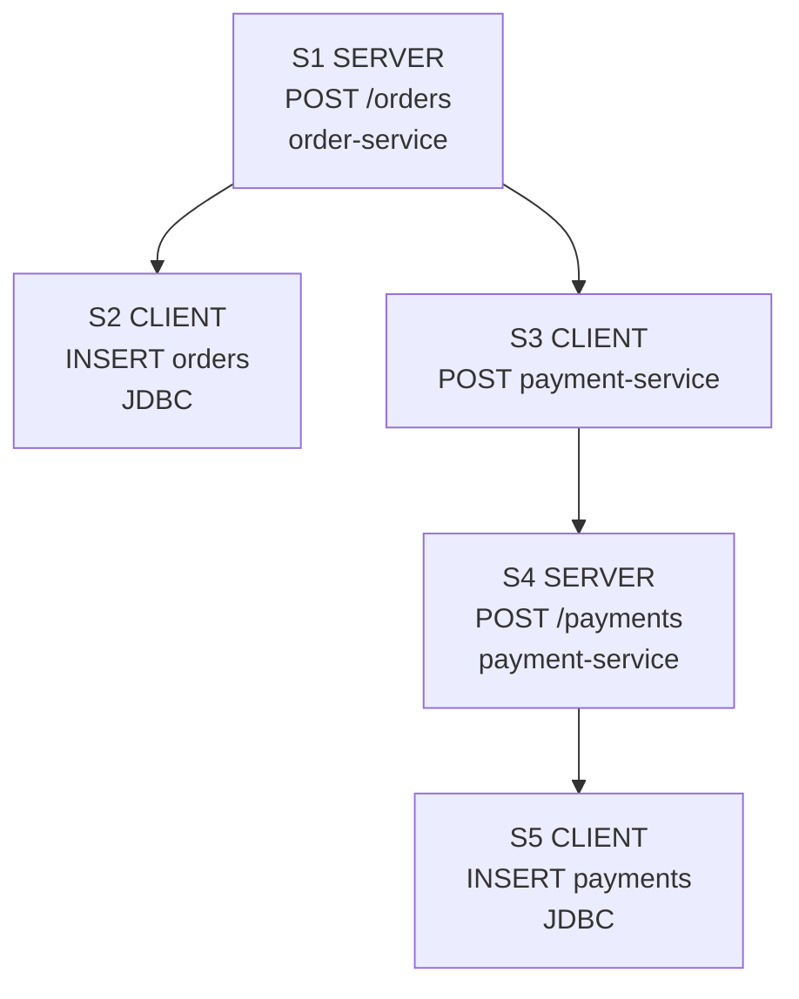

<Callout type="info" title="Kết quả sau bài này">
  Bạn sẽ biết khi nào dùng Java agent, khi nào viết instrumentation thủ công, cách
  gửi trace tới Collector và cách kiểm tra lifecycle trên JVM. Ví dụ dùng
  dependency không ghim phiên bản; trong dự án thật, hãy chọn một BOM/release đã
  kiểm thử và khóa nó trong dependency lock hoặc dependency management.
</Callout>

## Mục lục

- [Chọn Java agent hay SDK](#chọn-java-agent-hay-sdk)
- [Chuẩn bị Collector](#chuẩn-bị-collector)
- [Cách 1 Java agent zero-code](#cách-1-java-agent-zero-code)
  - [Chạy agent đúng thứ tự](#chạy-agent-đúng-thứ-tự)
  - [Cấu hình OTLP](#cấu-hình-otlp)
  - [Agent thấy gì](#agent-thấy-gì)
- [Java agent tạo span và span ID như thế nào](#java-agent-tạo-span-và-span-id-như-thế-nào)
  - [Agent nhận diện operation bằng instrumentation module](#agent-nhận-diện-operation-bằng-instrumentation-module)
  - [Ví dụ Spring JDBC và HTTP client](#ví-dụ-spring-jdbc-và-http-client)
  - [Quan hệ trace ID span ID và parent](#quan-hệ-trace-id-span-id-và-parent)
  - [Khi agent không tạo span](#khi-agent-không-tạo-span)
- [Cách 2 SDK và instrumentation thủ công](#cách-2-sdk-và-instrumentation-thủ-công)
  - [Dự án Spring Boot tối thiểu](#dự-án-spring-boot-tối-thiểu)
  - [Khởi tạo provider resource và exporter](#khởi-tạo-provider-resource-và-exporter)
  - [Tạo business span với Context và Scope](#tạo-business-span-với-context-và-scope)
  - [Metrics và logs](#metrics-và-logs)
- [Propagation qua HTTP](#propagation-qua-http)
- [Framework instrumentation](#framework-instrumentation)
- [Xác minh end to end](#xác-minh-end-to-end)
- [Shutdown và flush trên JVM](#shutdown-và-flush-trên-jvm)
- [Kiểm thử](#kiểm-thử)
- [Troubleshooting](#troubleshooting)
- [Thực hành production](#thực-hành-production)
- [Nguồn chính thức và bước tiếp theo](#nguồn-chính-thức-và-bước-tiếp-theo)

## Chọn Java agent hay SDK

**Java agent** là một JAR được JVM nạp trước application. Agent biến đổi bytecode
của các framework được hỗ trợ để tự tạo span, metric runtime và correlation cho
log. Đây là đường zero-code phù hợp để có nhanh HTTP, JDBC, messaging và client
spans mà không sửa source.

**Manual instrumentation** là code gọi OpenTelemetry API để mô tả operation
nghiệp vụ. Ví dụ, agent thấy `POST /checkout`, nhưng không thể tự suy ra bước
`inventory.reserve` có ý nghĩa gì. SDK là implementation xử lý sampling, batch
và export các record do API hoặc instrumentation tạo ra.

| Nhu cầu | Lựa chọn |
| --- | --- |
| Coverage framework nhanh, ít sửa code | Java agent |
| Business spans, domain metrics | OpenTelemetry API; agent hoặc SDK cung cấp provider |
| Kiểm soát hoàn toàn provider/processors | SDK thủ công hoặc SDK autoconfigure |
| Viết thư viện dùng lại | Chỉ phụ thuộc API; application sở hữu SDK |

<Callout type="warn" title="Không khởi tạo hai SDK">
  Khi chạy Java agent, agent đã cung cấp SDK toàn cục. Đừng đồng thời tạo một
  `SdkTracerProvider` khác trong application nếu chưa thiết kế rõ ownership; dữ
  liệu có thể bị tách provider, export hai lần hoặc shutdown sai. Manual spans
  vẫn dùng được: lấy tracer từ `GlobalOpenTelemetry`.
</Callout>

## Chuẩn bị Collector

Dùng Collector có OTLP receiver và `debug` exporter. OTLP là giao thức truyền
telemetry; receiver nhận dữ liệu, còn exporter `debug` chỉ in dữ liệu để kiểm tra.

```yaml title="otelcol.yaml"
receivers:
  otlp:
    protocols:
      grpc:
        endpoint: 0.0.0.0:4317
      http:
        endpoint: 0.0.0.0:4318
processors:
  batch: {}
exporters:
  debug:
    verbosity: detailed
service:
  pipelines:
    traces: { receivers: [otlp], processors: [batch], exporters: [debug] }
    metrics: { receivers: [otlp], processors: [batch], exporters: [debug] }
    logs: { receivers: [otlp], processors: [batch], exporters: [debug] }
```

```bash
docker run --rm --name otelcol \
  -p 127.0.0.1:4317:4317 -p 127.0.0.1:4318:4318 \
  -v "$PWD/otelcol.yaml:/etc/otelcol-contrib/config.yaml:ro" \
  otel/opentelemetry-collector-contrib:latest
```

`latest` chỉ tiện cho lab. Production phải pin image digest hoặc version đã qua
compatibility test.

## Cách 1 Java agent zero-code

Tải `opentelemetry-javaagent.jar` từ release chính thức của
[`opentelemetry-java-instrumentation`](https://github.com/open-telemetry/opentelemetry-java-instrumentation/releases),
rồi kiểm tra checksum từ cùng release. Không tải artifact mới ở mỗi lần container
khởi động.

### Chạy agent đúng thứ tự

`-javaagent` là tùy chọn của JVM, vì vậy phải đứng **trước** `-jar` hoặc main
class:

```bash
java -javaagent:/opt/otel/opentelemetry-javaagent.jar \
  -jar target/checkout-service.jar
```

Lệnh sau sai vì mọi token sau `-jar app.jar` được xem là argument của application:

```bash
java -jar target/checkout-service.jar -javaagent:/opt/otel/opentelemetry-javaagent.jar
```

Nếu có nhiều Java agent, thứ tự có thể ảnh hưởng bytecode transformation. Hãy
kiểm thử đúng tổ hợp và đúng thứ tự production; không giả định profiler/APM agent
khác tương thích.

### Cấu hình OTLP

Agent hỗ trợ biến môi trường chuẩn và Java system properties. Ví dụ OTLP/gRPC:

```bash
export OTEL_SERVICE_NAME=checkout-java
export OTEL_RESOURCE_ATTRIBUTES='deployment.environment.name=local,service.version=dev'
export OTEL_EXPORTER_OTLP_ENDPOINT='http://127.0.0.1:4317'
export OTEL_EXPORTER_OTLP_PROTOCOL=grpc
export OTEL_PROPAGATORS=tracecontext,baggage
export OTEL_METRICS_EXPORTER=otlp
export OTEL_LOGS_EXPORTER=otlp
java -javaagent:/opt/otel/opentelemetry-javaagent.jar -jar target/checkout-service.jar
```

System properties dùng tên chữ thường, chẳng hạn
`-Dotel.service.name=checkout-java` và
`-Dotel.exporter.otlp.endpoint=http://127.0.0.1:4317`. Đừng đặt cùng một giá trị
ở nhiều nguồn nếu chưa kiểm tra precedence. Với OTLP/HTTP, dùng port `4318` và
`http/protobuf`; endpoint signal-specific có thể cần path `/v1/traces`.

### Agent thấy gì

Với Spring MVC, agent thường tạo server span cho request, inject/extract W3C
`traceparent`, instrument HTTP clients và các thư viện database được hỗ trợ. Danh
sách chính xác phụ thuộc phiên bản agent và framework; kiểm tra
[supported libraries](https://opentelemetry.io/docs/zero-code/java/agent/supported-libraries/).

Agent **không tự tạo mọi business span**. Thêm span thủ công mà vẫn dùng SDK của
agent:

```java
private static final Tracer tracer =
    GlobalOpenTelemetry.getTracer("com.example.checkout");

Span span = tracer.spanBuilder("inventory.reserve").startSpan();
try (Scope ignored = span.makeCurrent()) {
  reserveInventory();
} catch (RuntimeException error) {
  span.recordException(error);
  span.setStatus(StatusCode.ERROR, "inventory reservation failed");
  throw error;
} finally {
  span.end();
}
```

**Agent extension** là plugin chạy trong class loader và lifecycle của agent.
Nó không phải nơi mặc định để đặt logic nghiệp vụ. Extension API có compatibility
risk cao hơn API công khai; chỉ dùng khi cần customize agent, pin agent-extension
pair và có test nâng cấp. Instrumentation trong application thường dễ sở hữu hơn.

## Java agent tạo span và span ID như thế nào

OpenTelemetry không đọc source code rồi tự suy luận rằng một dòng là SQL hoặc lời
gọi service. Java agent biết operation nhờ các **instrumentation module** được
viết riêng cho Servlet, Spring MVC, JDBC, HTTP clients, Kafka và các thư viện được
hỗ trợ khác.

Ranh giới trách nhiệm là:

```text
Instrumentation module phát hiện operation bắt đầu và kết thúc
        ↓
Tracer.startSpan() yêu cầu SDK tạo một span
        ↓
Active Context xác định parent
        ↓
SDK giữ hoặc sinh trace ID và luôn sinh span ID mới
        ↓
Instrumentation ghi name, kind, attributes, status rồi end span
```

`IdGenerator` trong SDK không biết SQL, HTTP hay Spring. Nó chỉ sinh ID khi
instrumentation đã quyết định bắt đầu span. Ngược lại, instrumentation không tự
chọn chuỗi ID; nó gọi OpenTelemetry API và để SDK sở hữu SpanContext.

### Agent nhận diện operation bằng instrumentation module

JVM nạp agent từ tùy chọn `-javaagent` trước application. Agent đăng cơ chế
bytecode transformation với JVM. Khi một class được load, instrumentation module
phù hợp kiểm tra class name, method signature và version/library compatibility,
rồi chèn logic tương đương method entry/exit hooks.

Ví dụ về các hook logic:

| Operation trong application | Method hoặc boundary được instrument | Span thường tạo |
| --- | --- | --- |
| Request vào Spring MVC | Servlet container và Spring request handling | HTTP `SERVER` span |
| `JdbcTemplate.update(...)` | JDBC `Statement` hoặc `PreparedStatement.execute*` phía dưới | Database `CLIENT` span |
| `RestTemplate` hoặc `WebClient` call | Spring HTTP client và HTTP transport được hỗ trợ | HTTP `CLIENT` span |
| Kafka publish/consume | Producer send và consumer receive/process boundary | `PRODUCER` hoặc `CONSUMER` span |
| Redis command | Method của Lettuce hoặc Jedis được hỗ trợ | Database/client span |
| Business method `validateFraud()` | Không có generic framework boundary | Không tự có span; cần manual instrumentation |

Mental model của một method JDBC sau khi được instrument:

```java
// Pseudocode mô tả hành vi, không phải source thật của agent.
Context parent = Context.current();
Span span = tracer.spanBuilder("INSERT orders")
    .setParent(parent)
    .setSpanKind(SpanKind.CLIENT)
    .startSpan();

try (Scope ignored = span.makeCurrent()) {
  return originalPreparedStatementExecuteUpdate();
} catch (Throwable error) {
  span.recordException(error);
  span.setStatus(StatusCode.ERROR);
  throw error;
} finally {
  span.end();
}
```

Method thật không bị sửa trên source tree. Agent transform bytecode được JVM chạy.
Module instrumentation còn áp dụng semantic conventions để đặt span name, kind và
attributes. Chính sách thu SQL statement, table name hoặc parameters phụ thuộc
instrumentation, version và cấu hình; không giả định agent sẽ hoặc nên ghi raw
query parameters.

Agent có thể hook nhiều lớp cho cùng một call, chẳng hạn `RestTemplate` và HTTP
transport bên dưới. Instrumentation chính thức có cơ chế context/suppression để
tránh tạo nested spans trùng lặp khi các lớp cùng biểu diễn một logical boundary.
Dù vậy, phải kiểm tra payload thật vì tổ hợp agent, starter và interceptor custom
vẫn có thể tạo duplicate spans.

### Ví dụ Spring JDBC và HTTP client

Order service sau nhận HTTP request, ghi database rồi gọi payment service:

```java title="OrderController.java"
@RestController
final class OrderController {
  private final JdbcTemplate jdbc;
  private final RestTemplate http;

  OrderController(JdbcTemplate jdbc, RestTemplate http) {
    this.jdbc = jdbc;
    this.http = http;
  }

  @PostMapping("/orders")
  Map<String, String> createOrder() {
    jdbc.update(
        "INSERT INTO orders(status) VALUES (?)",
        "PENDING");

    http.postForEntity(
        "http://payment-service/payments",
        Map.of("amount", 100_000),
        Void.class);

    return Map.of("status", "created");
  }
}
```

Nếu order service và payment service đều chạy Java agent, trace minh họa có thể
có dạng:



Tên và số lượng span cụ thể có thể thay đổi theo agent version, framework và
semantic conventions. Invariant cần kiểm tra là quan hệ trace/parent, không phải
snapshot mọi span name agent tạo ra.

Quá trình xảy ra như sau:

1. Servlet/Spring instrumentation nhận `POST /orders`, extract incoming context
   nếu có và tạo server span `S1`.
2. Agent làm `S1` active trong thời gian controller xử lý request.
3. `JdbcTemplate` đi xuống JDBC `PreparedStatement.executeUpdate()`. JDBC
   instrumentation thấy active `S1` và tạo client span `S2` làm child.
4. HTTP client instrumentation chặn lời gọi `RestTemplate`, tạo client span `S3`
   làm child của `S1`.
5. Trước khi gửi request, instrumentation inject context của `S3` vào
   `traceparent`.
6. Payment service extract header rồi tạo server span `S4` với `S3` làm remote
   parent.
7. JDBC instrumentation ở payment service tạo `S5` làm child của `S4`.
8. Mỗi hook end span ở success/error boundary tương ứng; SDK/processor export các
   recording spans bất đồng bộ.

JDBC span thường mô tả **lời gọi từ Java process tới database**. Nó không mặc
nhiên inject W3C `traceparent` vào database protocol và không có nghĩa database
engine đã tạo một server span tương ứng. Muốn quan sát internals của database cần
telemetry phía database hoặc integration riêng mà backend hỗ trợ.

### Quan hệ trace ID span ID và parent

Giả sử request tới order service chưa có valid `traceparent`. Khi Java agent yêu
cầu SDK tạo `S1`, SDK tạo trace ID `T1` và span ID mới cho `S1`. Những operation
sau giữ `T1` nhưng luôn có span ID riêng:

```text
S1  POST /orders
trace_id       = T1
span_id        = 1111111111111111
parent_span_id = none

S2  INSERT orders
trace_id       = T1
span_id        = 2222222222222222
parent_span_id = 1111111111111111

S3  POST payment-service
trace_id       = T1
span_id        = 3333333333333333
parent_span_id = 1111111111111111
```

Order service inject context của client span `S3`:

```http
traceparent: 00-4bf92f3577b34da6a3ce929d0e0e4736-3333333333333333-01
```

Payment service giữ trace ID nhưng sinh server span ID mới:

```text
S4  POST /payments
trace_id       = T1
span_id        = 4444444444444444
parent_span_id = 3333333333333333
```

Quy tắc SDK:

| Context lúc instrumentation gọi `startSpan()` | Trace ID | Span ID |
| --- | --- | --- |
| Không có valid parent | Sinh trace ID mới | Sinh span ID mới |
| Có active local parent | Giữ trace ID của parent | Sinh span ID mới |
| Có remote parent đã extract | Giữ trace ID của parent | Sinh span ID mới |
| Sampling trả `DROP` | Vẫn resolve trace ID | Vẫn sinh span ID cho non-recording SpanContext |

Do đó, Java agent không “gán trước” một span ID cố định cho JDBC hoặc HTTP.
Mỗi lần operation thực sự chạy, instrumentation gọi `startSpan()` và SDK sinh
span ID cho instance đó. Hai lần chạy cùng câu SQL tạo hai span IDs khác nhau.

<Callout type="idea" title="Cách nhớ">
  Instrumentation quyết định **khi nào** tạo span. Active `Context` quyết định
  **parent là ai**. SDK `IdGenerator` quyết định **ID mới là gì**. Propagator giữ
  trace liền mạch khi operation đi qua process hoặc network boundary.
</Callout>

### Khi agent không tạo span

Không phải mọi method Java đều có span. Agent chỉ tạo span khi có instrumentation
module hỗ trợ và module đó đang bật, tương thích với library version, đồng thời
operation thỏa điều kiện của instrumentation.

Ví dụ sau không tự có business span chỉ vì method name mô tả nghiệp vụ:

```java
fraudService.validateOrder(order);
calculateTotal(order);
mapRequestToEntity(request);
```

Nếu `validateOrder` cần được quan sát riêng, tạo manual child span bằng
OpenTelemetry API như phần tiếp theo. Không bọc lại JDBC hoặc HTTP boundary đã
được agent instrument; làm vậy thường tạo duplicate spans.

Khi thiếu span mong đợi, kiểm tra theo thứ tự:

1. agent có thực sự được nạp trước application không;
2. library và version có nằm trong supported libraries của agent đang chạy không;
3. instrumentation module có bị disable bằng config không;
4. method có đi qua đúng boundary mà module hook không;
5. active Context có bị mất qua executor, callback hoặc reactive boundary không;
6. span có bị sampling/drop hoặc export failure không;
7. starter, agent hoặc interceptor custom có suppress/duplicate instrumentation
   hay không.

## Cách 2 SDK và instrumentation thủ công

Đường này phù hợp khi không thể dùng agent hoặc cần sở hữu chính xác provider,
processor và exporter. Có hai biến thể:

- **SDK autoconfigure:** thêm module autoconfigure và gọi initializer/bootstrap
  theo tài liệu release. Cấu hình bằng `OTEL_*` hoặc `otel.*`.
- **SDK programmatic:** tạo resource, provider và exporter trong code như ví dụ
  dưới. Cách này rõ lifecycle nhưng application phải duy trì cấu hình.

### Dự án Spring Boot tối thiểu

Một Maven project coherent cần Spring Web, OpenTelemetry API/SDK và OTLP exporter:

```xml title="pom.xml (dependencies rút gọn)"
<dependencyManagement>
  <dependencies>
    <dependency>
      <groupId>io.opentelemetry</groupId>
      <artifactId>opentelemetry-bom</artifactId>
      <version>${opentelemetry.version}</version>
      <type>pom</type><scope>import</scope>
    </dependency>
  </dependencies>
</dependencyManagement>
<dependencies>
  <dependency>
    <groupId>org.springframework.boot</groupId>
    <artifactId>spring-boot-starter-web</artifactId>
  </dependency>
  <dependency><groupId>io.opentelemetry</groupId><artifactId>opentelemetry-api</artifactId></dependency>
  <dependency><groupId>io.opentelemetry</groupId><artifactId>opentelemetry-sdk</artifactId></dependency>
  <dependency><groupId>io.opentelemetry</groupId><artifactId>opentelemetry-exporter-otlp</artifactId></dependency>
  <dependency><groupId>io.opentelemetry</groupId><artifactId>opentelemetry-sdk-extension-autoconfigure</artifactId></dependency>
</dependencies>
```

`${opentelemetry.version}` phải được đặt thành release/BOM mà dự án đã kiểm thử.
Không copy một số version từ tutorial lâu dài. Nếu chỉ dùng programmatic setup,
module autoconfigure là tùy chọn.

### Khởi tạo provider resource và exporter

```java title="Telemetry.java"
public final class Telemetry implements AutoCloseable {
  private final SdkTracerProvider tracerProvider;
  private final OpenTelemetrySdk openTelemetry;

  public Telemetry(String endpoint) {
    Resource resource = Resource.getDefault().merge(Resource.create(
        Attributes.of(AttributeKey.stringKey("service.name"), "checkout-java")));
    OtlpGrpcSpanExporter exporter = OtlpGrpcSpanExporter.builder()
        .setEndpoint(endpoint).build();
    tracerProvider = SdkTracerProvider.builder()
        .setResource(resource)
        .addSpanProcessor(BatchSpanProcessor.builder(exporter).build())
        .build();
    openTelemetry = OpenTelemetrySdk.builder()
        .setTracerProvider(tracerProvider)
        .setPropagators(ContextPropagators.create(
            W3CTraceContextPropagator.getInstance()))
        .build();
  }

  public OpenTelemetry openTelemetry() { return openTelemetry; }

  @Override public void close() {
    tracerProvider.forceFlush().join(10, TimeUnit.SECONDS);
    tracerProvider.shutdown().join(10, TimeUnit.SECONDS);
  }
}
```

`Resource` mô tả entity phát telemetry; `service.name` phải ổn định giữa replica.
`BatchSpanProcessor` gom span trước khi export để giảm network overhead. Ví dụ
dùng `AttributeKey.stringKey("service.name")` nên chỉ cần các dependencies đã
liệt kê. Trong codebase đã khóa version, bạn có thể thêm semantic conventions
artifact tương thích với BOM và dùng constant do release đó cung cấp.

Đăng `Telemetry` thành singleton Spring bean và để Spring gọi `close()`:

```java
@Bean(destroyMethod = "close")
Telemetry telemetry(@Value("${otel.exporter.otlp.endpoint:http://localhost:4317}") String endpoint) {
  return new Telemetry(endpoint);
}
```

### Tạo business span với Context và Scope

```java title="CheckoutController.java"
@RestController
final class CheckoutController {
  private final Tracer tracer;

  CheckoutController(Telemetry telemetry) {
    tracer = telemetry.openTelemetry().getTracer("com.example.checkout", "1.0");
  }

  @PostMapping("/checkout/{cartId}")
  Map<String, String> checkout(@PathVariable String cartId) {
    Span span = tracer.spanBuilder("checkout.validate_cart").startSpan();
    try (Scope ignored = span.makeCurrent()) {
      span.setAttribute("app.cart.valid", true); // không ghi cartId: cardinality/PII
      return Map.of("status", "accepted");
    } catch (RuntimeException error) {
      span.recordException(error);
      span.setStatus(StatusCode.ERROR);
      throw error;
    } finally {
      span.end();
    }
  }
}
```

`Context` mang active span qua call chain. `Scope` tạm kích hoạt Context trên
thread hiện tại và phải đóng trên **chính thread đã mở nó**. Không truyền một
`Scope` sang executor. Với async work, capture `Context.current()`, rồi gọi
`context.wrap(runnable)` hoặc `context.makeCurrent()` bên trong worker.

### Metrics và logs

Java metrics SDK là stable. Tạo instrument một lần, không tạo trong mỗi request:

```java
LongCounter accepted = telemetry.openTelemetry().getMeter("com.example.checkout")
    .counterBuilder("checkout.accepted").setUnit("{order}").build();
accepted.add(1, Attributes.of(AttributeKey.stringKey("result"), "accepted"));
```

Để export metrics, cấu hình `SdkMeterProvider`, `PeriodicMetricReader` và OTLP
metric exporter, hoặc để agent/autoconfigure thực hiện. Attribute metric phải có
cardinality thấp; không dùng `cartId`, email hoặc URL thô.

OpenTelemetry Java logs SDK/API đã ổn định ở cấp signal, nhưng cách bridge từ
SLF4J/Logback và mức hỗ trợ của instrumentation phụ thuộc distro/release. Ưu tiên
structured logging và bridge chính thức của agent. Khi span active, bridge có thể
gắn trace ID/span ID; `System.out.println` tự nó không phải OTLP log exporter.
Kiểm tra pipeline logs riêng trước khi tuyên bố đã thu logs.

## Propagation qua HTTP

Propagation là việc serialize context vào carrier, thường là HTTP headers. W3C
Trace Context dùng header `traceparent`; `baggage` mang metadata được phép truyền.
Spring/client instrumentation của agent tự inject/extract cho library được hỗ
trợ. Với client custom, dùng `TextMapPropagator.inject`:

```java
Context context = Context.current();
openTelemetry.getPropagators().getTextMapPropagator().inject(
    context, requestBuilder, (builder, key, value) -> builder.setHeader(key, value));
```

Phía nhận phải extract headers **trước** khi tạo server/consumer span và làm
Context kết quả active. Không log toàn bộ baggage; nó đi qua trust boundary và
có thể chứa dữ liệu nhạy cảm. Không tự tạo `traceparent` bằng string formatting.

## Framework instrumentation

- Với Spring Boot, đường khuyến nghị để có HTTP/JDBC coverage rộng là Java agent.
- Nếu không dùng agent, đăng ký instrumentation library tương thích hoặc dùng
  Spring observability integration phù hợp. Chỉ thêm SDK không tự instrument
  controller.
- Tránh hai owner cùng instrument một boundary. Nếu agent đã tạo HTTP server
  span, controller chỉ tạo child business span.
- Spring Boot starter của OpenTelemetry là một distribution khác với Java agent.
  Đọc compatibility và configuration của đúng distribution; không trộn starter,
  agent và SDK programmatic theo suy đoán.

## Xác minh end to end

1. Chạy Collector ở trên và service.
2. Gửi `curl -i -X POST http://localhost:8080/checkout/demo`.
3. Tìm `service.name: checkout-java`, HTTP server span và
   `checkout.validate_cart` trong Collector log.
4. Kiểm tra hai span có cùng trace ID và business span có parent ID là server
   span khi framework instrumentation đang bật.
5. Gọi service B có instrument và kiểm tra service B giữ cùng trace ID. Đây mới
   chứng minh propagation, không chỉ chứng minh exporter hoạt động.

Nếu chỉ thấy business span trong manual SDK example, đó là bình thường: SDK không
tự instrument Spring. Chạy agent hoặc thêm framework instrumentation có chủ ý.

## Shutdown và flush trên JVM

Shutdown đúng thứ tự: ngừng nhận request, chờ in-flight work, `forceFlush`, rồi
`shutdown` provider trong timeout hữu hạn. `BatchSpanProcessor` giữ queue trong
memory nên `SIGKILL` có thể mất dữ liệu. Trong container, dùng `exec java ...` để
JVM nhận `SIGTERM` và đặt termination grace period dài hơn drain timeout.

Agent tự đăng shutdown hook. Với SDK programmatic, để Spring gọi bean destroy như
trên hoặc đăng đúng một JVM shutdown hook. Không đóng global provider sau từng
request. `forceFlush()` là best effort, không phải cam kết backend đã lưu dữ liệu.

## Kiểm thử

Unit test không nên cần Collector. Dùng `InMemorySpanExporter` từ testing artifact
và `SimpleSpanProcessor` để assertion đồng bộ:

```java
InMemorySpanExporter exporter = InMemorySpanExporter.create();
SdkTracerProvider provider = SdkTracerProvider.builder()
    .addSpanProcessor(SimpleSpanProcessor.create(exporter)).build();
// gọi controller/service với tracer của provider
List<SpanData> spans = exporter.getFinishedSpanItems();
assertThat(spans).extracting(SpanData::getName)
    .contains("checkout.validate_cart");
provider.close();
```

Ngoài tên span, hãy assert parent, status, attributes allowlist và không có ID
nhạy cảm. Integration test chạy app cùng Collector test container để kiểm tra
OTLP, resource và propagation. Không assert agent-generated span shape quá rộng;
chỉ giữ contract mà hệ thống thực sự phụ thuộc.

## Troubleshooting

| Triệu chứng | Kiểm tra và cách xử lý |
| --- | --- |
| Không có log agent lúc startup | Kiểm tra đường dẫn JAR, quyền đọc và `-javaagent` đứng trước `-jar` |
| Agent báo `Connection refused` | Khớp scheme, port `4317/4318`, protocol và network namespace; `localhost` trong container là chính container |
| Bật debug nhưng không có span framework | Chạy với `OTEL_JAVAAGENT_DEBUG=true`, tìm instrumentation match/transform error; chỉ bật tạm vì log rất lớn |
| Có root span nhưng mất parent | Kiểm tra `traceparent`, propagator hai phía và Context/Scope qua async boundary |
| Span duplicate | Tìm agent, Spring starter hoặc manual interceptor đang cùng sở hữu HTTP boundary |
| Process không thoát | Kiểm tra exporter thread, shutdown hook và timeout; không chờ vô hạn trong hook |
| Không có custom business span | Agent không suy ra nghiệp vụ; thêm OpenTelemetry API span thủ công |
| `ClassNotFoundException` trong extension | Extension và agent không tương thích; bỏ extension, pin cặp version và test riêng |

Agent debug có thể lộ class names, endpoints hoặc config. Chỉ bật trong canary,
redact log và tắt sau khi điều tra.

## Thực hành production

- Pin agent, BOM và Collector; kiểm tra checksum/SBOM và rollout canary.
- Đặt `service.name`, environment và version ổn định; để instance ID là duy nhất.
- Dùng batch processor, timeout và retry hữu hạn. Collector gần workload giúp
  cô lập backend và quản lý retry.
- Chọn parent-based sampling theo ngân sách; đo queue drops và export failures.
- Giữ span names ổn định, attribute cardinality thấp; không thu token, payload,
  SQL parameter hay PII nếu chưa có policy.
- Lập compatibility matrix cho JDK, Spring Boot, packaging, native image và mọi
  agent khác. Java agent không phải lựa chọn mặc định cho GraalVM native image.
- Có kill switch: bỏ `-javaagent` hoặc tắt từng instrumentation qua config rồi
  restart. Ghi lại config hiệu lực cùng deployment revision.

## Nguồn chính thức và bước tiếp theo

Các capability thay đổi theo release. Đối chiếu
[Java documentation](https://opentelemetry.io/docs/languages/java/),
[Java agent configuration](https://opentelemetry.io/docs/zero-code/java/agent/configuration/),
[Java instrumentation repository](https://github.com/open-telemetry/opentelemetry-java-instrumentation)
và [Java SDK repository](https://github.com/open-telemetry/opentelemetry-java).

<Cards>
  <Card title="Auto-instrumentation" href="/instrumentation/auto-instrumentation/" description="Hiểu agent, startup order và rollout." />
  <Card title="Manual instrumentation" href="/instrumentation/manual-instrumentation/" description="Thiết kế business spans, metrics và logs." />
  <Card title="Collector" href="/collector/" description="Xây pipeline nhận và xuất OTLP." />
</Cards>
