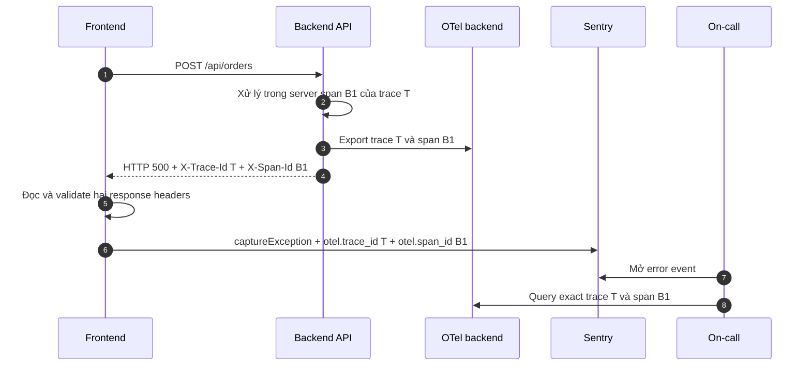

<Callout type="info" title="Kết luận ngắn">
  **Có thể lưu `trace_id` và `span_id` của OpenTelemetry vào Sentry event.**
  Cách đơn giản nhất là Backend trả hai ID qua response headers, Frontend đọc chúng
  rồi gắn vào đúng error event trong Sentry. `request_id` không bắt buộc trong
  thiết kế này. `trace_id` là khóa chính để mở trace; `span_id` giúp đi thẳng tới
  operation liên quan.
</Callout>

## Mục lục

- [Bài toán cần giải quyết](#bài-toán-cần-giải-quyết)
- [Mental model về các ID](#mental-model-về-các-id)
  - [Trace ID và span ID được tạo ở đâu](#trace-id-và-span-id-được-tạo-ở-đâu)
  - [Vì sao không cần request ID làm cầu nối chính](#vì-sao-không-cần-request-id-làm-cầu-nối-chính)
  - [Phân biệt ID của Sentry và ID của OpenTelemetry](#phân-biệt-id-của-sentry-và-id-của-opentelemetry)
- [Kiến trúc correlation đề xuất](#kiến-trúc-correlation-đề-xuất)
  - [Khi Frontend nhận được response](#khi-frontend-nhận-được-response)
  - [Khi request không có response](#khi-request-không-có-response)
- [Correlation contract](#correlation-contract)
  - [Response headers](#response-headers)
  - [Fields trên Sentry event](#fields-trên-sentry-event)
  - [CORS và proxy](#cors-và-proxy)
- [Cài đặt end to end](#cài-đặt-end-to-end)
  - [Backend Node.js và Express](#backend-nodejs-và-express)
  - [Frontend TypeScript và Sentry](#frontend-typescript-và-sentry)
  - [Gắn ID vào đúng event](#gắn-id-vào-đúng-event)
- [Hai mức triển khai](#hai-mức-triển-khai)
  - [Mức một Backend trả ID trong response](#mức-một-backend-trả-id-trong-response)
  - [Mức hai trace xuyên suốt từ Browser tới Backend](#mức-hai-trace-xuyên-suốt-từ-browser-tới-backend)
- [Workflow điều tra lỗi](#workflow-điều-tra-lỗi)
- [Sampling và trường hợp có ID nhưng không tìm thấy trace](#sampling-và-trường-hợp-có-id-nhưng-không-tìm-thấy-trace)
- [Bảo mật và dữ liệu nhạy cảm](#bảo-mật-và-dữ-liệu-nhạy-cảm)
- [Failure modes thường gặp](#failure-modes-thường-gặp)
- [Kiểm thử end to end](#kiểm-thử-end-to-end)
  - [Test case tối thiểu](#test-case-tối-thiểu)
  - [Checklist production](#checklist-production)
- [Takeaway](#takeaway)
- [Nguồn tham khảo chính thức](#nguồn-tham-khảo-chính-thức)
- [Bài liên quan](#bài-liên-quan)

## Bài toán cần giải quyết

Giả sử người dùng thao tác trên Frontend và request `POST /api/orders` trả về
`500`. Frontend bắt exception rồi gửi event lên Sentry. Trong khi đó, Backend đã
export trace sang Grafana Tempo, Jaeger hoặc một tracing backend khác.

Ta muốn đi theo đường sau mà không phải đoán bằng timestamp:

```text
Sentry error event
  └── otel.trace_id = 4bf92f3577b34da6a3ce929d0e0e4736
      └── mở trace trên Tempo hoặc Jaeger
          └── otel.span_id = 00f067aa0ba902b7
              └── mở đúng API span và xem child spans, logs, DB calls
```

Để làm được điều đó, hai hệ thống phải thống nhất một **correlation contract**.
Contract quy định Backend công bố ID nào, Frontend lưu ID dưới field nào và công
cụ điều tra dùng field đó để truy vấn ra sao.

<Callout type="idea" title="Mục tiêu không phải gửi trace vào Sentry hai lần">
  Sentry có thể chỉ giữ error event, còn Tempo hoặc Jaeger giữ OpenTelemetry
  traces. Ta chỉ chép các ID cần thiết vào Sentry để tạo đường nối giữa hai hệ
  thống. Nếu tổ chức dùng Sentry cho cả tracing thì có thể tích hợp sâu hơn, nhưng
  contract ID vẫn hữu ích để kiểm chứng.
</Callout>

## Mental model về các ID

### Trace ID và span ID được tạo ở đâu

`trace_id` nhận diện toàn bộ distributed trace. Dạng hex thông thường có 32 ký
tự. `span_id` nhận diện một operation trong trace và có 16 ký tự hex.

ID không phải lúc nào cũng được Backend đầu tiên tự tạo:

| Tình huống | Ai tạo `trace_id`? | Backend làm gì? |
| --- | --- | --- |
| Request không có valid parent context | SDK ở service nhận request đầu tiên | Tạo root/server span với trace ID mới |
| Browser gửi W3C `traceparent` | SDK trong Browser hoặc upstream | Extract context và tạo server span trong cùng trace ID |
| API Gateway đã instrument | Gateway hoặc upstream trước Gateway | Service phía sau tiếp tục trace qua propagation |
| Header propagation bị mất hoặc không hợp lệ | SDK tại boundary bị mất context | Tạo trace mới, làm trace end-to-end bị tách |

Mỗi span luôn có `span_id` riêng. Browser client span và Backend server span có
thể cùng `trace_id`, nhưng **không có cùng `span_id`**. Quan hệ parent-child nối
hai span đó lại.

### Vì sao không cần request ID làm cầu nối chính

`request_id` là correlation ID tùy chỉnh do ứng dụng, proxy hoặc API Gateway quản
lý. Nó vẫn hữu ích cho support hoặc hệ thống cũ, nhưng không chứa quan hệ của
trace tree.

| ID | Trả lời câu hỏi | Có cần trong thiết kế này không? |
| --- | --- | --- |
| `trace_id` | Toàn bộ request đã đi qua những operation nào? | Có, đây là khóa chính |
| `span_id` | Operation cụ thể nào liên quan tới lỗi? | Nên có khi xác định được |
| `request_id` | Request nào mang ID do ứng dụng hoặc proxy cấp? | Không bắt buộc; chỉ là fallback hoặc contract nghiệp vụ |
| Sentry event ID | Event lỗi nào đã được Sentry ingest? | Có trong Sentry, nhưng không tự mở được OTel trace |

Vì vậy, luồng Sentry → tracing backend có thể hoạt động chỉ với `trace_id` và
`span_id`. Không cần tạo thêm `request_id` chỉ để làm nhiệm vụ mà trace context đã
đảm nhiệm.

### Phân biệt ID của Sentry và ID của OpenTelemetry

Một Sentry event có thể đã có trace context riêng do Sentry SDK tạo. ID đó không
đương nhiên trùng với trace ID trong OpenTelemetry backend nếu hai tracing setup
hoạt động độc lập.

Để tránh nhầm lẫn:

- dùng custom tag `otel.trace_id` cho trace ID đang được lưu trong OTel backend;
- dùng custom tag `otel.span_id` cho span mục tiêu;
- thêm context `otel` để mô tả nguồn ID và vai trò của span;
- không tự ghi đè native Sentry trace context nếu chưa cấu hình integration chính
  thức giữa Sentry và OpenTelemetry.

Nếu đã cấu hình Sentry OpenTelemetry integration để hai hệ thống dùng cùng
context, hãy xác minh ID thực tế trên một request. Đừng suy luận rằng hai field có
cùng tên thì chắc chắn có cùng giá trị.

## Kiến trúc correlation đề xuất

### Khi Frontend nhận được response

Đây là đường đơn giản và dễ vận hành nhất. Backend đọc SpanContext đang active,
trả ID trong response, rồi Frontend gắn ID vào Sentry event của chính request đó.



Trong đường này, Frontend không cần tự tạo trace. Nó chỉ nhận ID của operation
Backend đã xử lý request.

### Khi request không có response

Nếu DNS lỗi, TLS lỗi, browser bị offline hoặc connection bị ngắt trước khi nhận
headers, Frontend không thể lấy ID từ response. Có hai khả năng:

1. Không bật browser tracing: Sentry event không có OTel Backend ID đáng tin cậy.
2. Browser đã tạo client span và inject `traceparent`: Frontend có thể lưu trace
   ID của client span. Backend sẽ dùng cùng trace ID nếu request đã tới nơi và
   context được extract thành công.

`span_id` của Browser trong trường hợp hai là client span, không phải Backend
server span. Hãy ghi rõ `span_role=client` hoặc bỏ `span_id` và chỉ tìm bằng
`trace_id`.

<Callout type="warn" title="Không có response không chứng minh Backend có trace">
  Request có thể chưa bao giờ rời Browser hoặc chưa tới service. Ngay cả khi
  Frontend có trace ID, tracing backend có thể không có Backend span nào cho ID
  đó. Hãy xem đây là đường tìm kiếm tốt nhất, không phải bằng chứng rằng Backend
  đã xử lý request.
</Callout>

## Correlation contract

### Response headers

Contract tối thiểu:

```http
X-Trace-Id: 4bf92f3577b34da6a3ce929d0e0e4736
X-Span-Id: 00f067aa0ba902b7
```

Quy tắc nên áp dụng:

- `X-Trace-Id` chứa đúng 32 ký tự lowercase hex và không phải toàn số `0`;
- `X-Span-Id` chứa đúng 16 ký tự lowercase hex và không phải toàn số `0`;
- ID phải lấy từ public OpenTelemetry API như `span.spanContext()`;
- không tự sinh ID khác chỉ để trả response;
- không trả header nếu không có valid active SpanContext;
- Gateway và CDN phải forward hai response headers mà không sửa giá trị.

`X-Trace-Id` và `X-Span-Id` là custom contract của ứng dụng. W3C Trace Context
chuẩn hóa request header `traceparent`, nhưng không quy định hai response headers
trên.

### Fields trên Sentry event

Một event đề xuất:

```json
{
  "tags": {
    "otel.trace_id": "4bf92f3577b34da6a3ce929d0e0e4736",
    "otel.span_id": "00f067aa0ba902b7"
  },
  "contexts": {
    "otel": {
      "trace_id": "4bf92f3577b34da6a3ce929d0e0e4736",
      "span_id": "00f067aa0ba902b7",
      "span_role": "server",
      "source": "backend_response"
    },
    "api": {
      "method": "POST",
      "route": "/api/orders",
      "status_code": 500
    }
  }
}
```

Tags là string key-value được Sentry index để filter và search. Context giữ dữ
liệu có cấu trúc để đọc trong event detail. Chép ID vào cả hai nơi là hợp lý khi
cần vừa tìm kiếm nhanh vừa giải thích nguồn ID.

Nếu chi phí index hoặc policy của dự án không cho phép high-cardinality custom
tags, chỉ giữ context và xây integration link phù hợp. Hãy quyết định dựa trên
cách Sentry project được truy vấn, không dựa trên metric cardinality của
OpenTelemetry. Đây là hai storage model khác nhau.

### CORS và proxy

Với request khác origin, Browser không cho JavaScript đọc custom response headers
nếu server không expose chúng:

```http
Access-Control-Expose-Headers: X-Trace-Id, X-Span-Id
```

Nếu Browser còn inject W3C trace headers để trace xuyên suốt, CORS preflight cũng
phải cho phép các request headers tương ứng, ví dụ:

```http
Access-Control-Allow-Headers: Content-Type, Authorization, traceparent, tracestate, baggage
```

Chỉ allow các origin và headers thực sự cần thiết. Reverse proxy, API Gateway và
CDN cũng phải được kiểm tra vì chúng có thể xóa custom response headers dù code
Backend đã set đúng.

## Cài đặt end to end

### Backend Node.js và Express

Ví dụ giả định OpenTelemetry HTTP/Express auto-instrumentation đã được khởi tạo
**trước khi** import Express. Middleware phải chạy bên trong active request
context và trước khi response được gửi.

```ts
import express from 'express';
import { isSpanContextValid, trace } from '@opentelemetry/api';

const app = express();

app.use((_req, res, next) => {
  const span = trace.getActiveSpan();
  const spanContext = span?.spanContext();

  if (spanContext && isSpanContextValid(spanContext)) {
    res.setHeader('X-Trace-Id', spanContext.traceId);
    res.setHeader('X-Span-Id', spanContext.spanId);
  }

  next();
});

app.post('/api/orders', async (_req, res) => {
  // Business logic chạy trong active request context.
  res.status(500).json({ error: 'payment_failed' });
});
```

Điểm cần kiểm chứng trong framework thực tế:

- `trace.getActiveSpan()` không trả `undefined`;
- trace ID trong response tồn tại trên exported trace;
- span ID trả về thuộc cùng trace và là span hữu ích để điều tra;
- middleware không bị chạy trước telemetry bootstrap;
- header được set trước `headersSent`.

Một số framework instrumentation tạo thêm internal hoặc route span. Khi đó,
active span tại middleware có thể không phải HTTP `SERVER` span mà bạn mong đợi.
Trace ID vẫn đúng. Nếu cần deep-link chính xác tới server span, dùng hook/API công
khai của instrumentation tương ứng hoặc lưu server span reference theo
request-scoped context, rồi kiểm thử span kind và span ID trên payload thật.

<Callout type="error" title="Không tự tạo span chỉ để lấy ID">
  Nếu request đáng lẽ đã được auto-instrument nhưng không có active span, hãy sửa
  bootstrap hoặc context propagation. Tạo một span rời trong middleware chỉ để
  trả header có thể làm Sentry trỏ tới một trace không phản ánh request thật.
</Callout>

### Frontend TypeScript và Sentry

Frontend nên validate ID trước khi gửi Sentry. Điều này ngăn proxy lỗi hoặc giá
trị ngoài contract trở thành tag tùy ý.

```ts
import * as Sentry from '@sentry/browser';

const TRACE_ID = /^[0-9a-f]{32}$/;
const SPAN_ID = /^[0-9a-f]{16}$/;

interface OtelCorrelation {
  traceId?: string;
  spanId?: string;
}

function readOtelCorrelation(response: Response): OtelCorrelation {
  const rawTraceId = response.headers.get('x-trace-id')?.toLowerCase();
  const rawSpanId = response.headers.get('x-span-id')?.toLowerCase();

  return {
    traceId:
      rawTraceId && TRACE_ID.test(rawTraceId) && !/^0+$/.test(rawTraceId)
        ? rawTraceId
        : undefined,
    spanId:
      rawSpanId && SPAN_ID.test(rawSpanId) && !/^0+$/.test(rawSpanId)
        ? rawSpanId
        : undefined,
  };
}

function captureApiError(
  error: unknown,
  correlation: OtelCorrelation,
  api: { method: string; route: string; statusCode?: number },
): void {
  const tags: Record<string, string> = {};

  if (correlation.traceId) tags['otel.trace_id'] = correlation.traceId;
  if (correlation.spanId) tags['otel.span_id'] = correlation.spanId;

  Sentry.captureException(error, {
    tags,
    contexts: {
      otel: {
        trace_id: correlation.traceId ?? 'unavailable',
        span_id: correlation.spanId ?? 'unavailable',
        span_role: 'server',
        source: 'backend_response',
      },
      api: {
        method: api.method,
        route: api.route,
        status_code: api.statusCode ?? 'unavailable',
      },
    },
  });
}
```

Dùng helper đó ngay tại nơi đã có cả exception và response:

```ts
export async function createOrder(input: unknown): Promise<unknown> {
  const method = 'POST';
  const route = '/api/orders';

  const response = await fetch(route, {
    method,
    headers: { 'content-type': 'application/json' },
    body: JSON.stringify(input),
  });

  const correlation = readOtelCorrelation(response);

  if (!response.ok) {
    const error = new Error(`Create order failed with HTTP ${response.status}`);

    captureApiError(error, correlation, {
      method,
      route,
      statusCode: response.status,
    });

    throw error;
  }

  try {
    return await response.json();
  } catch (cause) {
    const error = new Error('Create order returned invalid JSON', { cause });

    captureApiError(error, correlation, {
      method,
      route,
      statusCode: response.status,
    });

    throw error;
  }
}
```

Ví dụ giữ `route` ở dạng template ổn định. Không gửi raw URL có token, email,
order ID hoặc query string nhạy cảm vào Sentry context.

### Gắn ID vào đúng event

Không nên gọi `Sentry.setTag('otel.trace_id', ...)` ở scope rộng của Browser cho
mỗi API request. Browser có thể chạy nhiều request đồng thời. Một request có thể
ghi đè tag của request khác trước khi exception được capture.

Ưu tiên một trong hai cách:

1. truyền `tags` và `contexts` trực tiếp vào `captureException`, như ví dụ trên;
2. dùng `Sentry.withScope(...)` rồi set tag và capture exception bên trong callback
   đó.

Ví dụ với local scope:

```ts
Sentry.withScope((scope) => {
  scope.setTag('otel.trace_id', correlation.traceId!);
  if (correlation.spanId) {
    scope.setTag('otel.span_id', correlation.spanId);
  }

  scope.setContext('otel', {
    trace_id: correlation.traceId,
    span_id: correlation.spanId,
    source: 'backend_response',
  });

  Sentry.captureException(error);
});
```

Chỉ dùng toán tử `!` sau khi code đã kiểm tra `correlation.traceId`. Trong code
chung, bỏ tag nếu ID không tồn tại thay vì gửi string rỗng.

Ngoài ra, chỉ capture một lỗi một lần. Nếu API client đã `captureException` rồi
UI error boundary cũng capture cùng exception, Sentry có thể tạo duplicate
events. Một lựa chọn khác là gắn correlation vào custom error object và để error
boundary trung tâm capture.

## Hai mức triển khai

### Mức một Backend trả ID trong response

Đây là baseline phù hợp khi:

- traces bắt đầu ở Backend;
- mục tiêu chính là debug HTTP error có response;
- chưa muốn đưa OTel tracing SDK vào Browser;
- Sentry và tracing backend là hai hệ thống độc lập.

Ưu điểm:

- ít thành phần;
- dễ kiểm thử;
- `span_id` có thể trỏ thẳng tới operation Backend;
- không cần cho phép `traceparent` từ Browser.

Giới hạn:

- không xử lý tốt network error không có response;
- không thể hiện thời gian render hoặc Browser client span;
- trace chỉ bắt đầu ở Backend hoặc Gateway.

### Mức hai trace xuyên suốt từ Browser tới Backend

Ở mức này, Browser instrumentation tạo client span rồi inject W3C `traceparent`
vào `fetch` hoặc XHR. Backend extract header trước khi tạo server span.

```text
Browser client span F1
trace_id = T, span_id = F1
        │
        │ traceparent: ...-T-F1-...
        ▼
Backend server span B1
trace_id = T, span_id = B1, parent_span_id = F1
```

Mức hai phù hợp khi cần:

- trace cả user interaction, Browser request và Backend processing;
- correlation cho request mất response;
- phân biệt latency ở Browser, network và Backend;
- một trace end-to-end thật sự.

Tuy nhiên, phải cấu hình:

- Browser instrumentation chỉ inject trace headers tới allowlisted origins;
- Backend/Gateway cho phép `traceparent` trong CORS preflight;
- Backend dùng W3C Trace Context propagator tương thích;
- sampling và trust-boundary policy rõ ràng;
- Sentry SDK và OTel Browser SDK không tạo hai tracing setup xung đột.

Nếu Sentry và OpenTelemetry được khởi tạo độc lập trong Browser, đừng giả định
Sentry error tự mang OTel trace ID. Vẫn nên gắn `otel.trace_id` có chủ đích, hoặc
cấu hình integration được Sentry hỗ trợ và kiểm chứng ID end-to-end.

## Workflow điều tra lỗi

Giả sử Sentry event có:

```text
otel.trace_id = 4bf92f3577b34da6a3ce929d0e0e4736
otel.span_id  = 00f067aa0ba902b7
```

Quy trình điều tra:

1. Mở Sentry event và xác nhận `source=backend_response`.
2. Copy exact `otel.trace_id`; không copy Sentry event ID hoặc native trace ID
   khác nếu chúng chưa được đồng bộ.
3. Query tracing backend bằng exact trace ID.
4. Nếu backend hỗ trợ, mở trực tiếp `otel.span_id`.
5. Kiểm tra span đó có thuộc cùng trace, đúng service, route và thời điểm không.
6. Đọc child spans để tìm database call, external API hoặc queue operation lỗi.
7. Mở correlated logs bằng `trace_id` và `span_id` nếu log pipeline đã chèn trace
   context.
8. Quay lại metrics để đánh giá lỗi là một trường hợp riêng hay ảnh hưởng rộng.

Backend-neutral query contract:

```text
get_trace(trace_id)
get_span(trace_id, span_id)
find_logs(trace_id, span_id?, service_name?, time_window?)
```

OpenTelemetry không chuẩn hóa URL deep-link của Tempo, Jaeger, Datadog hoặc các
vendor khác. Có thể đặt link template trong runbook, dashboard hoặc một internal
correlation gateway thay vì hard-code vendor URL vào Frontend.

## Sampling và trường hợp có ID nhưng không tìm thấy trace

Một valid SpanContext có thể tồn tại trong process dù trace không được lưu ở
backend. Vì vậy, Frontend có thể nhận `X-Trace-Id` nhưng on-call query không thấy
trace.

Nguyên nhân thường gặp:

- head sampler quyết định không record/export trace;
- parent context từ upstream có sampled flag tắt;
- exporter hoặc Collector drop dữ liệu;
- trace và Sentry event đi vào project hoặc tenant khác nhau;
- trace chưa ingest xong khi error event đã xuất hiện;
- trace hết retention trước Sentry event;
- ID bị parser đổi casing, cắt số `0` đầu hoặc map sai field.

Với API errors quan trọng, cân nhắc tail sampling để giữ trace có status lỗi hoặc
attribute phù hợp. Tail sampling chỉ giúp nếu Collector quan sát đủ spans trước
khi quyết định và được cấu hình đúng. Nó không khôi phục dữ liệu đã mất trước
Collector.

<Callout type="warn" title="ID là địa chỉ, không phải bảo đảm retention">
  Việc trả trace ID cho Frontend chỉ cung cấp địa chỉ tra cứu. Sampling, export,
  tenant routing và retention quyết định dữ liệu có thực sự tồn tại ở tracing
  backend hay không.
</Callout>

## Bảo mật và dữ liệu nhạy cảm

Trace ID và span ID là opaque identifiers, không phải credential. Dù vậy, vẫn
cần policy rõ ràng:

- không dùng trace ID để authentication, authorization hoặc ownership check;
- coi `traceparent` từ Internet là input không tin cậy;
- giới hạn origin được phép gửi propagation headers;
- không trả baggage, `tracestate`, access token hoặc internal metadata trong
  response;
- không đưa request/response body vào Sentry chỉ để có thêm context;
- không đặt user ID, email hoặc raw URL nhạy cảm vào tags;
- bảo vệ deep-link tới tracing backend bằng authentication và tenant isolation;
- đánh giá việc công bố trace/span ID theo threat model của tổ chức.

Nếu service chấp nhận incoming trace context từ public client, client có thể ảnh
hưởng trace ID mà Backend tiếp tục sử dụng. Điều này không nguy hiểm nếu ID chỉ
phục vụ correlation, nhưng là lý do không được dùng nó như bằng chứng danh tính.

## Failure modes thường gặp

| Triệu chứng | Nguyên nhân thường gặp | Cách xử lý |
| --- | --- | --- |
| Response không có `X-Trace-Id` | SDK nạp sau Express, route không instrument hoặc mất active context | Preload telemetry trước application imports; kiểm tra active span |
| Header có trong Network tab nhưng JavaScript đọc `null` | CORS chưa expose custom response headers | Thêm `Access-Control-Expose-Headers` tại lớp trả response |
| Header có ở Backend nhưng mất ở Browser | Gateway, proxy hoặc CDN strip header | Allowlist và forward hai headers qua mọi hop |
| Trace ID tìm được nhưng span ID không tồn tại | Active span là non-recording, span bị drop hoặc ID lấy từ span khác | Xác minh span payload; coi trace ID là khóa chính |
| Sentry event mang ID của request khác | Dùng Browser-global `Sentry.setTag` trong các request đồng thời | Dùng event-local capture context hoặc `withScope` |
| Sentry có hai trace ID khác nhau | Native Sentry tracing và OTel tracing chưa tích hợp | Dùng namespace `otel.*`; cấu hình integration hoặc chỉ rõ nguồn ID |
| Network error không có ID Backend | Không nhận response headers | Bật Browser propagation hoặc chấp nhận không có Backend correlation |
| Browser và Backend có trace ID khác nhau | `traceparent` không được inject, CORS strip hoặc Backend không extract | Test W3C propagation tại boundary |
| Có trace ID nhưng tracing backend trả rỗng | Sampling, export failure, tenant mismatch hoặc retention | Kiểm tra sampler, Collector metrics, routing và retention |
| Nhiều Sentry events cho cùng lỗi | Capture ở API client và UI boundary | Chọn một capture owner hoặc đánh dấu error đã capture |

## Kiểm thử end to end

### Test case tối thiểu

Tạo một endpoint test trả lỗi có kiểm soát. Sau đó kiểm tra toàn bộ đường đi thay
vì chỉ unit test helper đọc headers.

1. Gọi endpoint và giữ response headers.
2. Xác nhận `X-Trace-Id` khớp regex 32 hex và `X-Span-Id` khớp 16 hex.
3. Query tracing backend bằng trace ID.
4. Xác nhận span ID tồn tại trong trace và thuộc service/route mong đợi.
5. Xác nhận Sentry event có hai custom tags đúng giá trị.
6. Từ Sentry, thực hiện quy trình mở trace theo runbook hoặc deep-link.
7. Test cross-origin để chắc JavaScript đọc được exposed headers.
8. Chạy hai request lỗi đồng thời và xác nhận ID không bị gắn chéo.
9. Test một trace bị sampling loại để UI/runbook xử lý trạng thái “không tìm thấy”.
10. Test network failure không có response để xác nhận fallback hoạt động đúng.

Có thể kiểm tra response contract nhanh bằng:

```bash
curl -i http://localhost:3000/api/orders
```

Kết quả cần thấy:

```http
HTTP/1.1 500 Internal Server Error
X-Trace-Id: 4bf92f3577b34da6a3ce929d0e0e4736
X-Span-Id: 00f067aa0ba902b7
Content-Type: application/json
```

### Checklist production

- [ ] Backend lấy ID từ valid active OpenTelemetry SpanContext.
- [ ] `trace_id` có 32 lowercase hex; `span_id` có 16 lowercase hex.
- [ ] Frontend validate ID trước khi gửi Sentry.
- [ ] Sentry dùng custom fields `otel.trace_id` và `otel.span_id` để tránh nhầm native context.
- [ ] ID được gắn theo từng event, không lưu vào Browser-global scope cho request cụ thể.
- [ ] CORS expose `X-Trace-Id` và `X-Span-Id`.
- [ ] Gateway, proxy và CDN bảo toàn response headers.
- [ ] Nếu Browser inject context, origin được allowlist và preflight cho phép propagation headers.
- [ ] Trace ID trong response mở được trace trên backend khi trace được sampled và ingest thành công.
- [ ] Span ID được xác minh là operation hữu ích; workflow vẫn hoạt động nếu chỉ có trace ID.
- [ ] Sampling và retention gap được mô tả rõ trong runbook.
- [ ] Không đưa IDs vào metric attributes.
- [ ] Không dùng trace/span ID cho xác thực hoặc phân quyền.
- [ ] Không gửi body, token, raw URL hoặc PII vào Sentry context.
- [ ] Hệ thống có một nơi capture lỗi để tránh duplicate Sentry events.

## Takeaway

Thiết kế tối thiểu nên là:

```text
Backend active SpanContext
  → X-Trace-Id + X-Span-Id
  → Frontend đọc và validate
  → Sentry event-local tags/context
  → query Tempo hoặc Jaeger bằng trace_id
  → thu hẹp tới span_id
```

`request_id` không bắt buộc cho đường nối này. Hãy xem `trace_id` là khóa chính
và `span_id` là con trỏ tới operation cụ thể. Nếu cần xử lý cả trường hợp không có
response, nâng cấp sang Browser tracing với W3C `traceparent`, nhưng vẫn phải
kiểm chứng sampling, CORS và integration giữa Sentry với OpenTelemetry.

## Nguồn tham khảo chính thức

- [OpenTelemetry Trace API — SpanContext](https://opentelemetry.io/docs/specs/otel/trace/api/#spancontext) — định nghĩa trace ID, span ID, trace flags và tính hợp lệ của SpanContext.
- [W3C Trace Context](https://www.w3.org/TR/trace-context/) — định dạng và quy tắc propagation của `traceparent` và `tracestate`.
- [OpenTelemetry Context propagation](https://opentelemetry.io/docs/concepts/context-propagation/) — cách inject và extract context qua boundary.
- [OpenTelemetry JavaScript HTTP instrumentation](https://github.com/open-telemetry/opentelemetry-js/tree/main/experimental/packages/opentelemetry-instrumentation-http) — instrumentation và hooks cho HTTP/HTTPS Node.js.
- [Sentry JavaScript Tags](https://docs.sentry.io/platforms/javascript/enriching-events/tags/) — tags được index và dùng để filter/search event.
- [Sentry JavaScript Scopes](https://docs.sentry.io/platforms/javascript/enriching-events/scopes/) — global, isolation và current scope; cách dùng `withScope` cho một event.
- [Sentry JavaScript API](https://docs.sentry.io/platforms/javascript/configuration/apis/) — `captureException`, capture context, tags và contexts.
- [Sentry OpenTelemetry support cho Node.js](https://docs.sentry.io/platforms/javascript/guides/node/opentelemetry/) — integration giữa Sentry SDK và OpenTelemetry.

## Bài liên quan

<Cards>
  <Card title="Signal correlation" href="/signals/correlation/" description="Nối metrics, traces và logs bằng trace ID, span ID, exemplars và Resource." />
  <Card title="Traces" href="/signals/traces/" description="Hiểu trace tree, critical path và distributed trace." />
  <Card title="Spans" href="/signals/spans/" description="Hiểu SpanContext, span ID, lifecycle và quan hệ parent-child." />
  <Card title="Context propagation" href="/fundamentals/context-propagation/" description="Giữ trace context qua Browser, HTTP và service boundaries." />
  <Card title="JavaScript và Node.js" href="/languages/javascript-nodejs/" description="Thiết lập OpenTelemetry SDK và HTTP instrumentation cho Node.js." />
  <Card title="Sampling" href="/signals/sampling/" description="Hiểu vì sao có trace ID nhưng tracing backend không giữ trace." />
</Cards>
